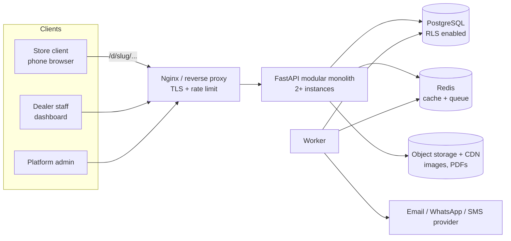

# DarijaStock SaaS — Multi-Tenant Architecture

> **IMPORTANT:** read `darijastock-saas-addendum.md` too. It overrides this file on: store login (phone + OTP), subdomain URLs, multi-dealer privacy, store approval, hosting/backups, and the credit/balance module (v1). Where they disagree, the addendum wins.

> Goal: turn DarijaStock from a single-company app into a SaaS used by ~40 big dealers (wholesalers). Each dealer gives a link to ~50 store clients. Stores place orders, orders appear in that dealer's dashboard, and no dealer can ever see another dealer's data.
>
> Give this file to OpenCode **phase by phase** (section 14), not all at once.

---

## 1. Vocabulary (use these names everywhere in code and UI)

| Term | Meaning | DB table |
|------|---------|----------|
| **Tenant / Dealer** (الموزع) | A big dealer who pays for the SaaS | `tenants` |
| **Staff user** (موظف) | Dealer employee: admin, order operator, stock manager… | `users` + `memberships` |
| **Customer / Store** (الزبون / المتجر) | A small store that buys from a dealer | `customers` |
| **Platform admin** | You (the SaaS owner) | `users.is_platform_admin` |

Today's "customer" in the code = tomorrow's `customers` row **belonging to one tenant**.

---

## 2. Capacity reality check (assumptions)

- 40 dealers × 50 stores = **2,000 stores**
- Each store orders ~2 days/week → ~**4,000 orders/week** (~17k/month, ~210k/year)
- ~10 lines per order → ~**2 M order lines/year** (~10 M in 5 years)
- Peak: Monday morning. Suppose 30% of the week's orders in one day and 60% of those in 3 hours → ~720 orders in 3h ≈ 4 orders/minute. Browsing dominates: ~30 requests per order session → ~2 requests/second. Even with a 10× safety margin: ~20 req/s.
- Users: ~2,000 stores + ~200 staff.

**Conclusion:** this is a small workload for PostgreSQL. You do **not** need microservices, Kubernetes, sharding or NoSQL.
Your real risks are **(1) data isolation between dealers, (2) onboarding friction for stores, (3) correctness of prices/stock, (4) reliability/backups**. The architecture below spends the complexity there.

---

## 3. Main decisions

| Decision | Choice | Why |
|----------|--------|-----|
| Architecture style | **Modular monolith** (one FastAPI app, strict modules) | Simple to run, deploy, debug. Split later only if needed. |
| Tenancy model | **Shared database, shared schema, `tenant_id` on every business table + PostgreSQL Row-Level Security (RLS)** | Cheapest to operate with 40 tenants; RLS makes isolation enforced by the database, not by developer discipline. |
| Upgrade path | A very large dealer can later move to a dedicated database (same code, different connection) | Enterprise option without redesign. |
| Store (client) login | **No password.** Personal ordering link (magic link) per store, optional phone-OTP later | Small shop owners do not want accounts. Dealer sends the link on WhatsApp. |
| Catalog | **One catalog per dealer**; prices via **price lists**; visibility via **customer groups** | Matches how wholesalers really work. |
| Tenant resolution | Staff: from the JWT. Public/store: from the URL slug `/d/{slug}` (subdomain later) | No ambiguity, easy caching. |
| Background work | Redis + a worker (Arq or RQ) | Notifications, PDFs, imports, emails. |
| Files | S3-compatible object storage + CDN for product images and logos | Not in the container, not in the DB. |

---

## 4. System overview



Three "surfaces" in one frontend build, three route groups:

| Surface | Routes | Auth |
|---------|--------|------|
| **Store ordering** | `/d/:slug/order`, `/d/:slug/orders`, `/d/:slug/track` | Customer session (from magic link) or guest by phone |
| **Dealer dashboard** | `/app/...` (today's admin pages) | Staff JWT + role |
| **Platform admin** | `/platform/...` | Platform admin JWT |

---

## 5. Data model

### 5.1 Rules for every business table

1. `tenant_id BIGINT NOT NULL REFERENCES tenants(id)`.
2. `UNIQUE (tenant_id, id)` so children can use a **composite foreign key** `(tenant_id, parent_id)`. A row can then never point to another tenant's row.
3. Natural keys are unique **per tenant**: `UNIQUE (tenant_id, sku)`, `UNIQUE (tenant_id, order_number)`.
4. Every list query index starts with `tenant_id`.
5. Money = `NUMERIC(12,2)`. Quantities = `NUMERIC(12,3)`. Timestamps = `timestamptz` (UTC).
6. Soft-delete with `is_active` / `archived_at`; never hard-delete orders or invoices.

### 5.2 Tables

**Platform level** (no RLS, only platform admin / system access)
- `tenants` — `id, slug, name, status (trial|active|suspended|cancelled), plan_id, logo_url, brand_color, created_at`
- `plans` — `id, name, max_staff, max_customers, max_products, max_orders_per_month, price_mad`
- `subscriptions` — `tenant_id, plan_id, status, current_period_end`
- `users` — `id, email (unique), password_hash, full_name, is_platform_admin, is_active`
- `memberships` — `user_id, tenant_id, role` (a user may belong to several tenants)

**Tenant level** (RLS on all of them)
- `tenant_settings` — `tenant_id, min_order_amount, order_cutoff_time, open_registration (bool), auto_confirm (bool), allow_backorder (bool), delivery_note, order_prefix`
- `customers` — `id, tenant_id, code, name, phone, city, address, price_list_id, group_id, status (pending|active|blocked), created_by`
- `customer_groups` — `id, tenant_id, name`
- `customer_access_tokens` — `id, tenant_id, customer_id, token_hash, expires_at, revoked_at, last_used_at`
- `categories` — `id, tenant_id, name_ar, name_fr, sort_order`
- `products` — `id, tenant_id, sku, name, name_ar, category_id, base_unit, base_price, image_url, is_active, is_public`
- `product_units` — `id, tenant_id, product_id, unit_code, factor_to_base, is_default` (e.g. carton = 12 bottles)
- `price_lists` — `id, tenant_id, name, is_default`
- `price_list_items` — `tenant_id, price_list_id, product_id, unit_code, price`
- `product_group_rules` — `tenant_id, group_id, product_id, visible (bool)` (hide or show products per group)
- `stock_levels` — `tenant_id, product_id, physical, reserved` (+ `warehouse_id` later)
- `stock_movements` — append-only ledger
- `orders` — `id, tenant_id, order_number, customer_id, status, source (public|staff|whatsapp_import), subtotal, discount_total, tax_total, total, customer_note, internal_note, idempotency_key, created_at`
- `order_items` — `id, tenant_id, order_id, product_id, unit_code, quantity, unit_price (snapshot), line_total, raw_text, match_status`
- `order_status_history`
- `invoices`, `invoice_items`
- `import_batches`
- `audit_log` — `tenant_id, actor_type, actor_id, action, entity_type, entity_id, details jsonb, created_at`
- `idempotency_keys` — `tenant_id, key, request_hash, response_json, created_at` with `UNIQUE (tenant_id, key)`
- `tenant_counters` — `tenant_id, name, value` (for per-tenant order/invoice numbers)

### 5.3 SQL pattern (example for orders)

```sql
CREATE TABLE customers (
  id          BIGSERIAL PRIMARY KEY,
  tenant_id   BIGINT NOT NULL REFERENCES tenants(id),
  code        TEXT NOT NULL,
  name        TEXT NOT NULL,
  phone       TEXT NOT NULL,
  status      TEXT NOT NULL DEFAULT 'active',
  UNIQUE (tenant_id, id),
  UNIQUE (tenant_id, code),
  UNIQUE (tenant_id, phone)
);

CREATE TABLE orders (
  id            BIGSERIAL PRIMARY KEY,
  tenant_id     BIGINT NOT NULL REFERENCES tenants(id),
  order_number  TEXT NOT NULL,
  customer_id   BIGINT NOT NULL,
  status        TEXT NOT NULL,
  total         NUMERIC(12,2) NOT NULL,
  idempotency_key TEXT,
  created_at    TIMESTAMPTZ NOT NULL DEFAULT now(),
  UNIQUE (tenant_id, id),
  UNIQUE (tenant_id, order_number),
  UNIQUE (tenant_id, idempotency_key),
  FOREIGN KEY (tenant_id, customer_id) REFERENCES customers (tenant_id, id)
);

CREATE INDEX ix_orders_tenant_created ON orders (tenant_id, created_at DESC);
CREATE INDEX ix_orders_tenant_status  ON orders (tenant_id, status, created_at DESC);
CREATE INDEX ix_orders_tenant_cust    ON orders (tenant_id, customer_id, created_at DESC);
```

### 5.4 Per-tenant numbering (gap-free, race-safe)

```sql
INSERT INTO tenant_counters (tenant_id, name, value) VALUES (:t, 'order', 1)
ON CONFLICT (tenant_id, name) DO UPDATE SET value = tenant_counters.value + 1
RETURNING value;
```
Order number = `{order_prefix}-{yy}{mm}-{value:06d}` (for example `AB-2610-000123`). Run it inside the same transaction as the order insert.

### 5.5 Growth plan
- Up to ~10 M order rows: nothing special, indexes are enough.
- Beyond that: partition `orders`, `order_items`, `stock_movements`, `audit_log` by month (`PARTITION BY RANGE (created_at)`).
- Keyset pagination (`WHERE (created_at, id) < (:c, :i)`) for very long lists; offset pagination is fine up to a few thousand rows per tenant view.

---

## 6. Tenant isolation (the most important part)

Use **three layers**. Any one of them failing must not leak data.

### Layer 1 — PostgreSQL Row-Level Security (fail-closed)

```sql
ALTER TABLE orders ENABLE ROW LEVEL SECURITY;
ALTER TABLE orders FORCE  ROW LEVEL SECURITY;

CREATE POLICY tenant_isolation ON orders
  USING      (tenant_id = NULLIF(current_setting('app.tenant_id', true), '')::bigint)
  WITH CHECK (tenant_id = NULLIF(current_setting('app.tenant_id', true), '')::bigint);
```
Apply the same policy to **every** tenant-level table (generate it in an Alembic helper loop so no table is forgotten).
If `app.tenant_id` is not set, the policy returns **zero rows**. That is the safe failure.

Database roles:
- `darijastock_owner` — runs migrations only.
- `darijastock_app` — used by the API. **Not** a superuser, **not** the table owner, no `BYPASSRLS`.
- `darijastock_system` — separate role with `BYPASSRLS`, used only by platform-admin code paths and background jobs that need cross-tenant work (billing, cleanup). Never used by tenant requests.

### Layer 2 — Request context sets the tenant for the transaction

```python
# app/core/db.py  (adapt to the project's sync/async style)
from contextvars import ContextVar
from sqlalchemy import text

current_ctx: ContextVar["RequestContext | None"] = ContextVar("ctx", default=None)

async def get_db(ctx: RequestContext = Depends(get_request_context)):
    async with SessionLocal() as session:
        async with session.begin():
            # true = local to this transaction, so it is safe with PgBouncer transaction pooling
            await session.execute(
                text("SELECT set_config('app.tenant_id', :t, true)"),
                {"t": str(ctx.tenant_id)},
            )
            yield session
```

`RequestContext` = `{tenant_id, user_id | customer_id, actor_type, role, permissions}`.
- Staff: built from the JWT (`tid`, `sub`, `role`). Verify the membership still exists and the tenant is not suspended (cache 60 s).
- Store: built from the customer session cookie.
- Public endpoints: resolved from `{slug}` through a cached `slug → tenant_id` lookup.

### Layer 3 — Code discipline
- Repositories always take the session from `get_db` and never build their own.
- Services never accept `tenant_id` from request bodies or query params. It only comes from the context.
- A lint rule / test fails if a new model with `tenant_id` has no RLS policy (query `pg_policies` in a test).

### Mandatory isolation test suite
Create 2 tenants with data. For **every** endpoint, call it as tenant A with tenant B's ids and assert 404 (not 403, to avoid confirming existence). Also assert that SQL run without `app.tenant_id` returns no rows. This test must run in CI and block merges.

---

## 7. Authentication & authorization

### 7.1 Staff (dealer employees)
- Email + password (Argon2 or bcrypt), JWT access token (15 min) + refresh token (httpOnly cookie, rotated, stored hashed).
- JWT claims: `sub`, `tid` (active tenant), `role`, `exp`.
- A user in several tenants picks the active one (tenant switcher); switching issues a new token.
- Roles stay as today (`admin, order_operator, stock_manager, order_approver, invoice_operator, read_only`), but they are now **per tenant**, stored in `memberships.role`. The existing permission names keep working.
- Login rate limit: 5 attempts / 15 min / (email + IP). Lockout with a generic message.

### 7.2 Store clients (the simple part for beginners)

Flow:
1. Dealer adds a client (or imports a CSV of clients) → system creates a `customers` row and a **personal ordering link**: `https://app.darijastock.ma/d/{slug}/o?t={token}`.
2. Dealer shares it from the dashboard with one tap: **"Send on WhatsApp"** (`https://wa.me/{phone}?text=...`) or "Copy link" or "Show QR".
3. Store opens the link. The frontend calls `POST /public/{slug}/session {token}`. The server verifies the **hash** of the token, sets an httpOnly, SameSite=Lax cookie (customer session, 30 days, sliding), and the frontend removes `?t=` from the URL.
4. The store is now recognised: name, price list and group are known. No form to fill again.

Rules:
- Token = 32 random bytes (urlsafe). Store only `sha256(token)`.
- Dealer can revoke/regenerate a client's link (lost phone, ex-client).
- Customer session scope is **read/write only to that customer's data**.

**Open registration (optional per dealer, `open_registration = true`)**: the generic dealer link `/d/{slug}/order` lets a new store enter name + phone. The system creates a customer with `status = pending`. Orders from pending customers land in the dealer's **"New clients to approve"** queue, and the dealer approves or rejects. This protects the dealer from random orders.

**Guest by phone (fallback)**: if the store has no personal link, it can still order from the generic link; the phone is matched against `customers` of that tenant. Tracking always needs `order_number + phone` and is scoped by `{slug}`.

Later (phase 2): phone OTP via WhatsApp/SMS for stores that change devices.

### 7.3 Platform admin
- Separate route group and separate login. `is_platform_admin` users only.
- "Impersonate dealer" for support: short-lived token with an `impersonator_id` claim, a visible banner in the UI, and every action written to `audit_log`.

### 7.4 Authorization checks
Dependency `require_permission("approve_orders")` on every staff endpoint, reading the permissions of the role in the **current tenant**. Admin of tenant A is not admin anywhere else.

---

## 8. Catalog, pricing and stock (how products are split)

**Ownership:** products belong to a dealer (`products.tenant_id`). Two dealers can both have SKU `COCA-1L`; they are different rows.

**Pricing resolution (server side, one function, unit-tested):**
```
price(customer, product, unit) =
    price_list_items[customer.price_list_id, product, unit]
 ?? price_list_items[tenant default list, product, unit]
 ?? product.base_price × unit.factor_to_base
```
- `order_items.unit_price` is a **snapshot** taken at order time. Later price changes never alter old orders.
- The browser never sends prices. It sends `{product_id, unit_code, quantity}`; the server computes everything.

**Visibility:** a product is shown to a customer if `is_active AND is_public` and no `product_group_rules` row hides it for the customer's group.

**Units:** a product has a base unit and optional sale units with a conversion factor (carton, pack). Stock is always kept in the base unit.

**Stock shown to stores:** only "available / low / unavailable", never exact numbers (dealers usually do not want to expose them). `allow_backorder` decides if an unavailable product can still be ordered.

**Stock rules (unchanged from today):** a public order does **not** deduct stock. Confirm → reserve. Fulfill → physical out. Cancel → release. Use `SELECT … FOR UPDATE` on `stock_levels` rows when reserving, in a stable order (by product_id) to avoid deadlocks.

**Bulk onboarding:** Excel/CSV import for products, customers and price lists with a preview step ("120 rows OK, 3 errors") and a downloadable error report. Imports run in the worker; the UI polls progress.

**Later:** an optional shared master catalog (barcodes, brand images) that a dealer can "adopt" into its own catalog. Not in the first version.

---

## 9. Order lifecycle

```
store submits  ──►  new / pending_review ──► confirmed (stock reserved) ──► preparing ──► fulfilled ──► invoiced
                          │                          │
                          └──────── cancelled ◄──────┘
```
- `auto_confirm = true` (per tenant): trusted customers' orders skip the approval queue.
- `min_order_amount` and `order_cutoff_time` are checked by the server and explained clearly in the UI.
- Single source of truth for statuses stays `lib/status.ts` on the frontend and one enum module on the backend.
- **Idempotency:** `POST /public/{slug}/orders` requires header `Idempotency-Key` (UUID created when the store reaches the confirm step). Same key + same payload → returns the original response. This removes duplicate orders from double taps and retries.
- Every status change writes `order_status_history` and `audit_log`.

---

## 10. API design

Base: `/api/v1`. Generate TypeScript types from OpenAPI (`openapi-typescript`) so frontend and backend cannot drift.

| Surface | Examples |
|---------|----------|
| Staff | `GET /orders`, `GET /orders/{id}`, `POST /orders/{id}/confirm`, `GET /products`, `POST /customers`, `POST /customers/{id}/access-link`, `GET /customers/pending` |
| Store | `GET /public/{slug}/catalog`, `POST /public/{slug}/session`, `GET /store/me`, `GET /store/orders`, `POST /store/orders`, `POST /store/orders/{id}/reorder` |
| Guest | `POST /public/{slug}/orders`, `POST /public/{slug}/orders/track` |
| Platform | `GET /platform/tenants`, `POST /platform/tenants`, `PATCH /platform/tenants/{id}`, `POST /platform/tenants/{id}/impersonate` |

Rules: pagination everywhere; consistent error shape `{code, message, field?}`; `429` with `Retry-After`; never return another tenant's id existence (use 404).

---

## 11. Code architecture

### 11.1 Backend (FastAPI)

```
app/
  core/            config, db, security, context, errors, rate_limit, logging
  modules/
    tenants/       models, schemas, router, service     (platform + settings)
    auth/          login, refresh, memberships, customer sessions
    catalog/       products, units, categories, price lists, visibility
    customers/     customers, groups, access links, approval
    orders/        orders, items, status machine, public ordering, tracking
    inventory/     stock levels, ledger, reserve/release/fulfill
    invoicing/
    imports/       csv/excel + whatsapp text import
    notifications/ in-app, email, whatsapp
    platform/      platform admin, plans, subscriptions
  workers/         arq tasks
  main.py
alembic/
tests/
  isolation/       cross-tenant tests (mandatory)
```

Layering per module: `router → service → repository`.
- Router: validation, auth dependency, HTTP only.
- Service: business rules, transactions, calls other modules **only through their service interfaces**.
- Repository: SQL only.
- Modules never import each other's repositories or models directly.

### 11.2 Frontend (React + TS)

```
src/
  app/            routing, providers (TenantProvider, AuthProvider, QueryClient)
  features/
    orders/ catalog/ customers/ inventory/ invoices/ reports/ users/
    store-ordering/   (public flow)
    platform/
  components/ui/  design system (already exists)
  lib/            money, status, labels, validators
```
- Introduce **TanStack Query** for server state (caching, retries, background refetch). It replaces the hand-written fetching in `useListPage` over time.
- `TenantProvider` loads tenant branding (logo, `brand_color`) and exposes it as CSS variables: `--brand`, so each dealer gets its own colour/logo while the layout and components stay identical.
- Route guards by surface (`StaffRoute`, `StoreRoute`, `PlatformRoute`).

---

## 12. User experience

### 12.1 Store client (most important to get right)
Principles: one phone, one thumb, repeat buyers.
1. Opens the WhatsApp link → **already recognised** ("مرحبا {store name}").
2. Home shows **"عاود الطلب السابق"** (reorder last order) as the biggest button. Most wholesale orders repeat. One tap fills the cart with the last order's items; unavailable items are flagged.
3. Catalog: search, categories, **favorites / "ديما كتشري"** (most-bought products first), large +/− buttons.
4. Review cart → confirm. Customer info is pre-filled and not asked again.
5. Success: order number, estimated handling message from dealer settings, a "track" button.
6. "طلباتي" page lists past orders and their statuses (replaces the manual track form for known stores).

### 12.2 Dealer staff
1. **Today screen**: new orders (with sound/badge), orders waiting approval, pending new clients, low stock.
2. **Inbox for new orders**: new orders appear without refresh (start with polling every 20–30 s using `If-None-Match`; move to SSE if needed), plus a browser notification and optional WhatsApp/email notification via the worker.
3. **Onboarding wizard** (first login): 1) company info + logo, 2) import products (Excel template provided), 3) import clients, 4) "Send links to clients" (one-tap WhatsApp per client or bulk copy), 5) test order.
4. **Clients page**: status (active/pending/blocked), last order date, "send link", "revoke link".

### 12.3 Platform admin
Tenant list, plan and status, usage (orders this month, staff, customers), suspend/reactivate, impersonate with audit.

---

## 13. Non-functional requirements

**Performance**
- PgBouncer (transaction mode) in front of PostgreSQL; API pool sized per worker.
- Cache the public catalog per tenant and price list in Redis (TTL 60 s, invalidated when products/prices change).
- Images through CDN with resized variants (thumbnail 200 px for the catalog grid).
- All list endpoints paginated; no unbounded queries.

**Security**
- RLS + tests (section 6). HTTPS only, HSTS, secure cookies.
- Rate limits: login, session exchange, track, public order creation (per IP and per tenant).
- Input validation with Pydantic, output never includes other tenants' ids or internal notes.
- Secrets in environment/secret manager, never in the repo.
- Uploads: type and size check, random filenames, served from the CDN domain.
- Dependency scanning in CI.
- Personal data (names, phones): define retention and deletion rules and check Moroccan data-protection requirements (Law 09-08 / CNDP) with a lawyer before launch.

**Reliability**
- Managed PostgreSQL (or self-managed) with **daily backups + point-in-time recovery**, and a **restore test every month**.
- 2 API instances behind the proxy; health checks; zero-downtime deploys (rolling).
- Staging environment identical to production.
- Structured JSON logs with `tenant_id` and `request_id`; Sentry for errors; metrics (request latency, error rate, queue length, DB connections); uptime monitor with alert to your phone.

**Cost-aware start:** one 4 vCPU / 8 GB server (or a small managed setup) runs this load comfortably. Grow when metrics say so, not before.

**Business layer**
- `plans` with limits enforced server-side (max staff, customers, products, orders/month). Suspended tenant → store ordering page shows a friendly "unavailable" message, staff get read-only access.
- Billing can start manual (invoice + bank transfer, you toggle `subscriptions.status`) and be automated later.

**Product gaps worth planning for wholesale in Morocco** (not in v1, but design for them): customer credit/balance and payment follow-up (many dealers sell on credit), delivery rounds/routes, multiple warehouses, Arabic + French invoices with ICE/RC/IF fields, WhatsApp order intake.

---

## 14. Migration from today's single-tenant app (zero data loss)

Do this in **separate Alembic migrations**, each deployable on its own, after a full backup.

1. Create `tenants`, `plans`, `memberships`, `tenant_settings`, `tenant_counters`. Insert **tenant #1** (the current company, slug of your choice).
2. Add `tenant_id BIGINT NULL` to every business table. **Backfill** with tenant #1. Then set `NOT NULL`.
3. Add `UNIQUE (tenant_id, id)`, replace global uniques (`sku`, `code`, `order_number`, `number`) with per-tenant uniques, add composite foreign keys, add tenant-first indexes.
4. Move existing users into `memberships (tenant #1)`. Keep their roles.
5. Application code: add `RequestContext`, `get_db` with `set_config`, update repositories. Deploy **with RLS still off**; verify everything works.
6. Switch the API to the non-owner DB role, enable RLS + policies. Run the isolation test suite.
7. Convert the current `/public/order` and `/public/track` to `/d/{slug}/...` and keep a redirect from the old URLs to tenant #1.
8. Replace the old `/public/orders` single-tenant behaviour with slug-scoped endpoints and idempotency keys.

Rollback plan for every step (down-migration or restore).

---

## 15. Roadmap (give OpenCode one phase at a time)

| Phase | Scope | Done when |
|-------|-------|-----------|
| **0** | Audit current code; confirm decisions in section 16 | Written report, no code |
| **1 — Tenancy core** | Migrations 1–4, RequestContext, memberships, JWT with `tid`, per-tenant numbering | App works for tenant #1 exactly as before |
| **2 — Isolation** | RLS policies, DB roles, isolation test suite in CI | Cross-tenant tests all green |
| **3 — Catalog & pricing** | Units, price lists, groups, visibility, Excel/CSV import | Dealer can import products/clients |
| **4 — Store experience** | Access links, session exchange, `/d/{slug}` flow, reorder, favorites, my orders, idempotency | Store orders from a WhatsApp link in under 1 minute |
| **5 — Dealer experience** | Today screen, new-order notifications, pending clients, onboarding wizard | New dealer is live in a day without your help |
| **6 — Platform** | Platform admin, plans/limits, impersonation, branding | You can create/suspend a dealer from the UI |
| **7 — Hardening** | Backups + restore test, monitoring, rate limits, load test, security review | Load test: 20 req/s for 30 min, p95 < 500 ms |
| **8 — Pilot** | 2–3 real dealers for 3–4 weeks, then open to the rest | Fix list closed |

**Load test (Phase 7):** simulate 2,000 stores with k6 or Locust, Monday-morning profile, mixed browse/submit/track traffic, plus a dealer dashboard polling.

---

## 16. Decisions to confirm before Phase 1

1. **Store identity:** personal magic link (recommended) vs phone OTP from day one?
2. **Can one store buy from several dealers?** (v1: separate `customers` row per dealer, linked only by phone.)
3. **URL style:** `app.domain/d/{slug}` (simple) vs `{slug}.domain` (nicer branding, needs wildcard DNS/TLS)?
4. **Open registration** default: off (dealer approves new stores) — agree?
5. **Pricing model for you:** per dealer per month, tiered by orders/clients? (affects `plans`.)
6. **Hosting:** where will it run (country, provider), and who owns backups/monitoring?
7. **Credit/balance for stores:** needed in v1 or v2?

---

## 17. Execution message for OpenCode (Phase 1 example)

```
Read darijastock-saas-architecture.md fully. We are executing PHASE 1 ONLY (Tenancy core, sections 5, 7.1, 14 steps 1–4).

Do first: inspect the existing models, Alembic history, auth code and every query that touches orders, products, customers, invoices and stock. Write a short audit listing every table that needs tenant_id and every global unique constraint that must become per-tenant.

Then implement: new platform tables, tenant #1 backfill, tenant_id on all business tables (nullable → backfill → NOT NULL), per-tenant uniques and composite FKs, memberships, JWT claim tid, RequestContext, tenant_counters-based order/invoice numbers.

Rules: the app must behave exactly as before for tenant #1. Do not enable RLS yet. Do not change the public pages yet. Every migration must have a downgrade. Add tests for numbering, composite FKs and the migration backfill. Run the full test suite, type check and build. Report: files changed, migration order, and anything that needs my decision.
```
